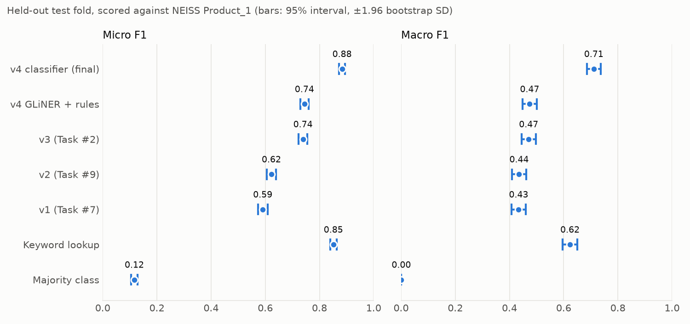

# Final evaluation on a held-out test set

## Summary

- The final model is **v4**. GLiNER with the v4 span rules names the object, and a TF-IDF linear classifier assigns the NEISS product code.
- The v4 classifier reaches **micro F1 0.88**, **macro F1 0.71** and **exact-match accuracy 0.88** on 3,000 held-out narratives. It beats v3 by **0.14** micro F1 (95% interval 0.13 to 0.16) and **0.24** macro F1.
- Object extraction itself barely moved. v4's GLiNER step scores micro F1 0.74, within 0.01 of v3. The gain comes from the classifier, which predicts codes and does not name objects.
- In a hand review of 50 classifier errors, 9 were real model mistakes (v3: 22 of 50). Most of the rest named another product in the text or a sibling code.
- The test set was scored once, after the team chose the classifier on validation results. What changed in v4, and the validation numbers, are in [reports/v4_validation.md](https://github.com/Break-Through-Tech/Marsh-McLennan-1A-object-detection-model/blob/main/reports/v4_validation.md).

## Test set

- **Source:** 3,000 narratives sampled at random from the 11 test-fold hospitals in `reports/split_by_psu.csv` (`data/eval/test_set_neiss.csv`). No earlier task tuned on these hospitals, and v4 was developed on the validation fold.
- **Excluded:** the 25 hand-labeled development cases, the 300-row sample used to write the keyword rule, and any narrative whose text also appears in a train or validation hospital.
- **Ground truth:** the NEISS product code (`Product_1`).
- **Scoring:** the GLiNER systems (v1 to v4) output text ("STEPS"), so each span is mapped to a code by a lexicon built from training-fold narratives only. Every GLiNER system uses the same lexicon. The classifier and the keyword lookup output codes directly.

## Results

| System | Micro P | Micro R | Micro F1 | Macro P | Macro R | Macro F1 | Exact match |
|---|---:|---:|---:|---:|---:|---:|---:|
| v1 (baseline) | 0.71 | 0.51 | 0.59 | 0.50 | 0.43 | 0.43 | 0.51 |
| v2 | 0.68 | 0.58 | 0.62 | 0.50 | 0.44 | 0.44 | 0.58 |
| v3 | 0.77 | 0.71 | 0.74 | 0.52 | 0.47 | 0.47 | 0.71 |
| v4 GLiNER + rules | 0.77 | 0.72 | 0.74 | 0.52 | 0.48 | 0.47 | 0.72 |
| **v4 classifier (final)** | **0.88** | **0.88** | **0.88** | **0.73** | **0.72** | **0.71** | **0.88** |
| Keyword lookup | 0.85 | 0.85 | 0.85 | 0.65 | 0.63 | 0.62 | 0.85 |
| Majority class (floor) | 0.12 | 0.12 | 0.12 | 0.00 | 0.00 | 0.00 | 0.12 |

- **Micro** pools all cases. Precision = correct / answered; recall = correct / all 3,000.
- **Macro** averages per-class scores over the 320 product classes in the test set.
- **Exact match** = share of all cases where the predicted code equals `Product_1`. With one gold code per case, this equals micro recall.

**Paired bootstrap differences (95% intervals):**

| | Micro F1 | Macro F1 | Exact match |
|---|---|---|---|
| v4 classifier − v3 | +0.144 (0.130 to 0.159) | +0.240 (0.213 to 0.268) | +0.171 (0.156 to 0.186) |
| v4 classifier − keyword lookup | +0.032 (0.023 to 0.041) | +0.088 (0.067 to 0.109) | +0.032 (0.023 to 0.041) |
| v4 GLiNER − v3 | +0.005 (0.002 to 0.008) | +0.004 (0.000 to 0.008) | +0.009 (0.006 to 0.013) |
| v3 − v1 | +0.148 (0.134 to 0.163) | +0.037 (0.022 to 0.052) | +0.206 (0.190 to 0.222) |
| v3 − v2 | +0.117 (0.103 to 0.130) | +0.035 (0.020 to 0.050) | +0.137 (0.123 to 0.151) |

## Findings

- **The classifier is the main v4 gain.** It gets 587 cases right that v3 misses; v3 gets 74 right that it misses. It also beats the keyword lookup by 0.03 micro F1 (0.02 to 0.04) and 0.09 macro F1.
- **It helps rare and workplace-like products most.** Macro F1 rises 0.24, compared with 0.04 from v1 to v3. On tools, ladders, doors, glass and machinery (210 cases), micro F1 rises from 0.70 (v3) to 0.85.
- **The v4 span rules are close to neutral on NEISS.** v4 GLiNER fixes 29 cases and loses 1 compared with v3. The rules were kept for workplace text, where a truck or forklift is often the object (see [reports/v4_validation.md](v4_validation.md)).
- **The classifier and the keyword lookup predict codes, not objects.** Both are trained on the NEISS codes they are scored against. GLiNER still names the object, and the output's `agree` column shows where GLiNER's object and the classifier's code point to the same product.
- **v3 improved on v1 by answering more often without losing precision.** v3 answers 93% of cases against v1's 71%, and its precision is higher (0.77 vs 0.71). v3 gets 668 cases right that v1 misses; v1 gets 50 right that v3 misses. That gain was concentrated in floors, stairs, beds and sports.

## Error analysis

### v4 classifier

The classifier made 350 errors. It always answers, so there are no OTHER or unmapped cases:

| Error type | Cases | Share |
|---|---:|---:|
| Different product | 178 | 51% |
| Matches a secondary NEISS product (`Product_2`/`Product_3`) | 172 | 49% |

The most common confusion is floor → bed (12 cases), which is usually a fall from a bed to the floor where the coder chose the floor. Most of the rest are sibling codes, such as four-wheel vs unspecified ATVs or e-bikes vs bicycles.

A random sample of 50 errors was reviewed by hand:

| Cause | Cases | Examples |
|---|---:|---|
| Several products named, coder picked another | 20 | bed and floor; knife and glass jar; microwave and hot water |
| Right object, sibling code | 14 | utility knife: knives NEC vs replaceable blades; sun chair vs folding chair |
| Chose the wrong product | 9 | dust pan → cookware; "fall from a chair" → stairs; plywood → tools |
| Object not in the text | 7 | redacted object; paintbrush implied by "painting" |

9 of the 50 (18%) are real model errors, against 22 of 50 for v3. Another 34 (68%) are scoring artifacts or defensible answers, and 7 (14%) cannot be solved from the text. Most of the classifier's remaining errors are therefore disagreements with the coder's choice, not misreadings.

### v3

v3 made 863 errors:

| Error type | Cases | Share |
|---|---:|---:|
| Span maps to a different product | 347 | 40% |
| No answer (OTHER) | 217 | 25% |
| Matches a secondary NEISS product (`Product_2`/`Product_3`) | 191 | 22% |
| Floor or keyword fallback rule was wrong | 78 | 9% |
| Span has no lexicon entry | 30 | 3% |

The most common confusions involve floors (monkey bars → floor, floor → bed, stairs → floor) and sibling codes (unspecified scooter → powered scooter).

A random sample of 50 errors was reviewed by hand:

| Cause | Cases | Examples |
|---|---:|---|
| Missed a named object | 12 | earring, door, bleach, slide, stove |
| Chose the wrong span | 10 | "LIP LACERATION" instead of electric scooter; "CEMENT" instead of wagon |
| Right object, sibling code or mapping | 13 | scooter: powered vs unspecified; "ball" mapped to soccer |
| Several products named, coder picked another | 9 | chair and table; floor and bucket |
| Object not in the text | 6 | redacted object; knife implied by "cutting a cucumber" |

22 of the 50 (44%) are real model errors. Another 22 (44%) are scoring artifacts or defensible answers, and 6 (12%) cannot be solved from the text. So strict code matching understates how often v3 names an acceptable object.

## Limitations

- **The ground truth is a proxy.** NEISS codes record the coder's chosen product, not the object named in the text. No hand labels were collected for the test set, so object-level accuracy is not measured.
- **The classifier learned NEISS wording.** How well it transfers to Marsh's workers' compensation text is unknown. Checking that needs sample narratives from Marsh.
- **GLiNER scores depend on the lexicon.** Mapping errors count against v1 to v4 equally. The classifier does not use the lexicon.
- **Macro F1 rests on thin classes.** 291 of the 320 classes have fewer than 20 test cases.
- **One product per case.** Every system predicts a single object or code, but 17.5% of test cases have more than one product code.

v4 changes and validation results: [reports/v4_validation.md](v4_validation.md). Full tables: `reports/final_eval_results.md`. Per-case results: `reports/final_eval_details.csv`. Reviewed error samples: `reports/final_eval_error_sample_classifier.csv` and `reports/final_eval_error_sample_v3.csv`.
