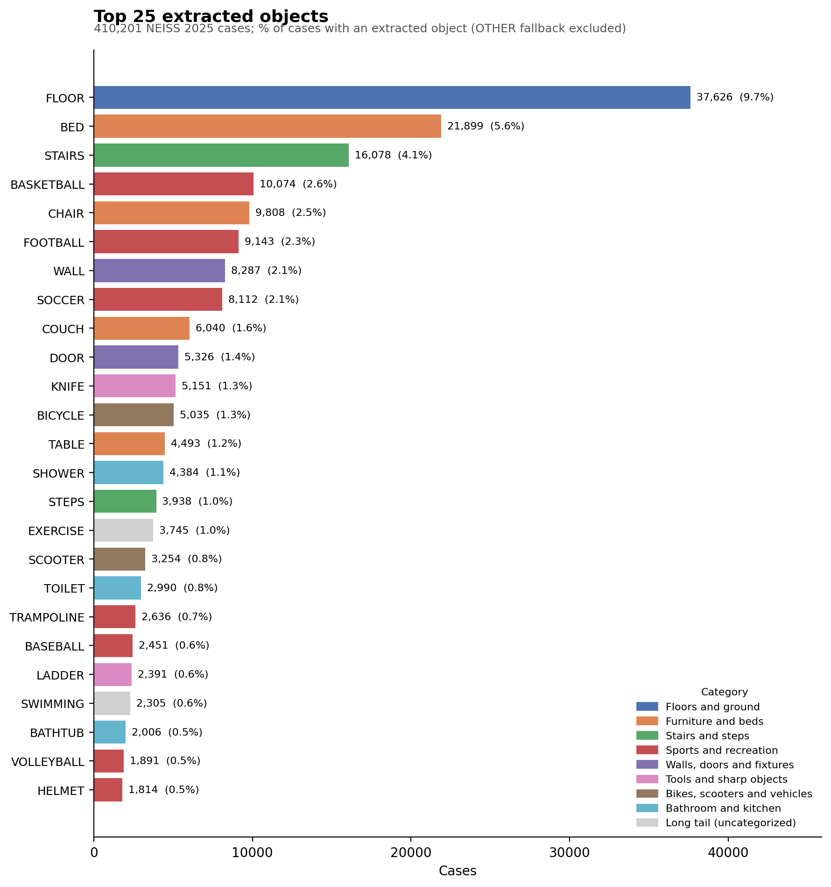
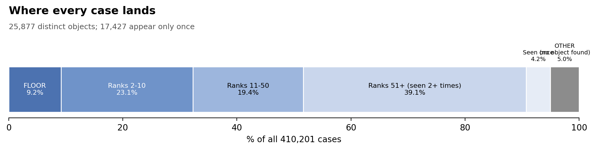
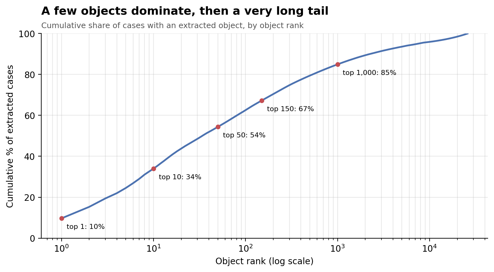
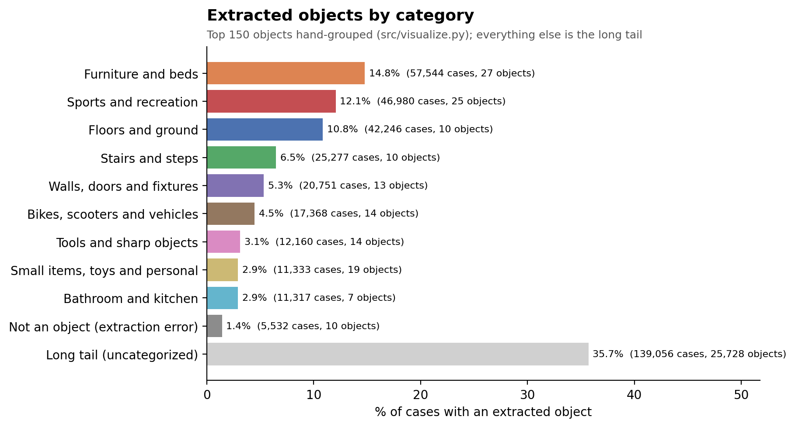
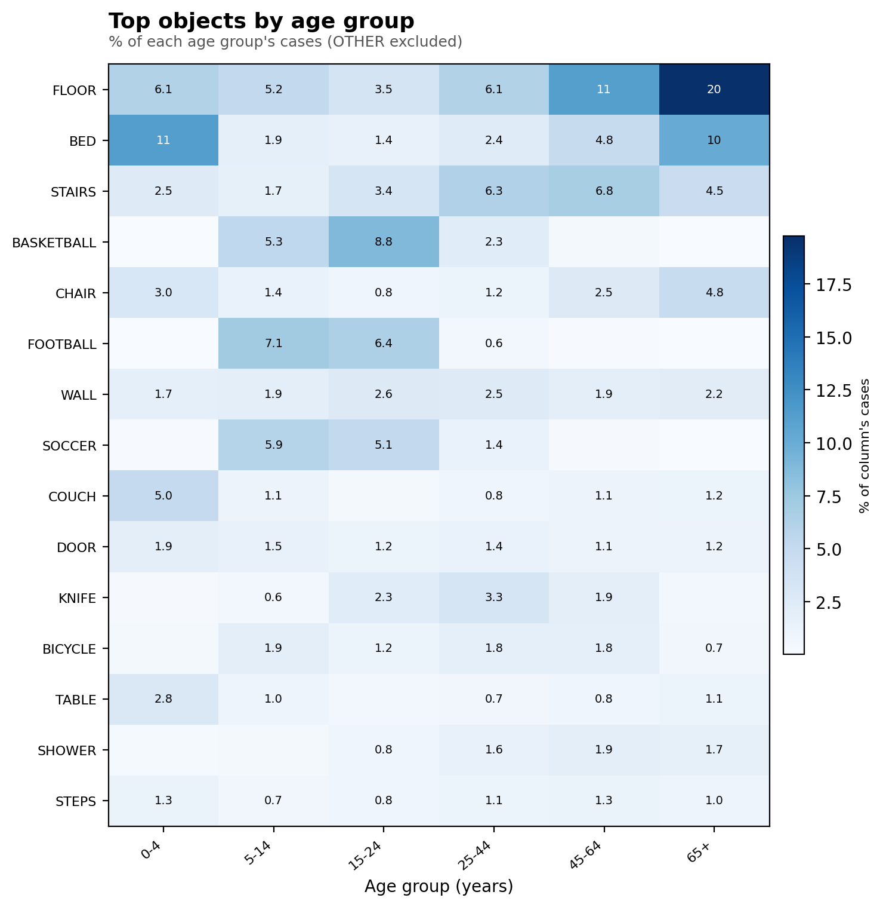
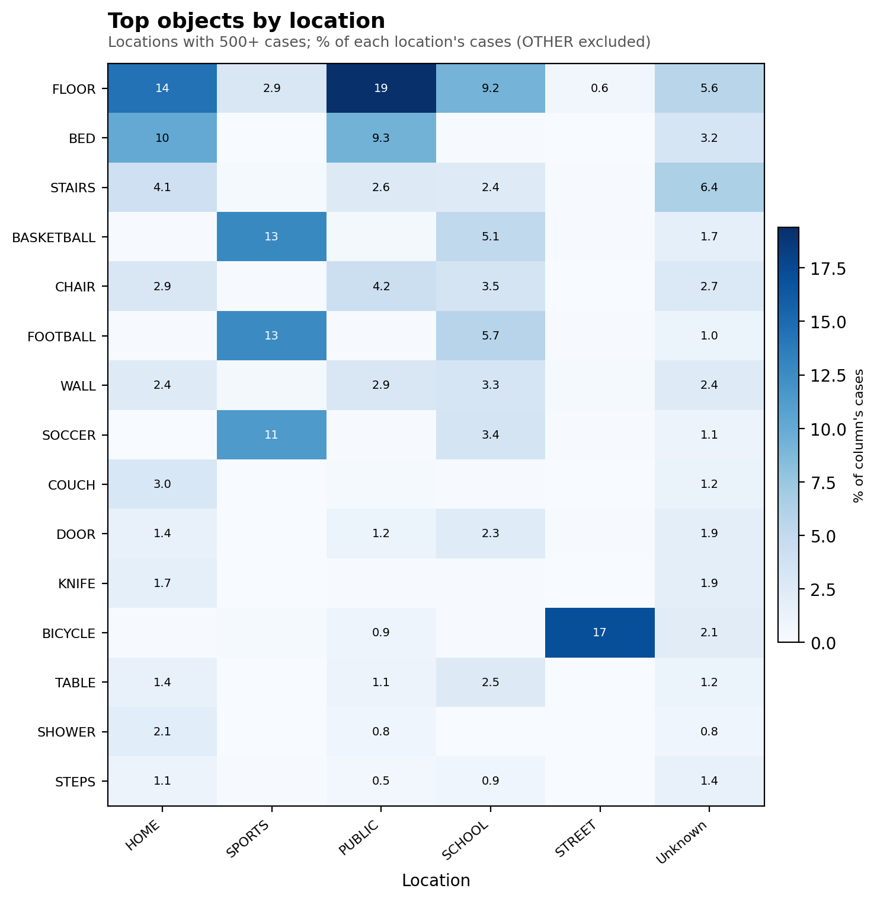
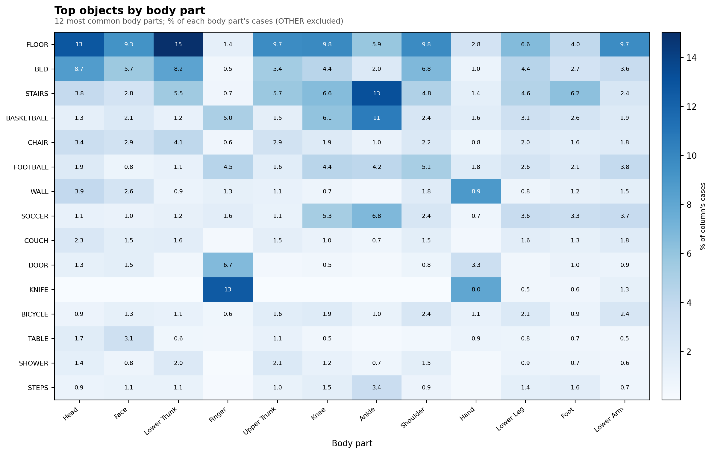
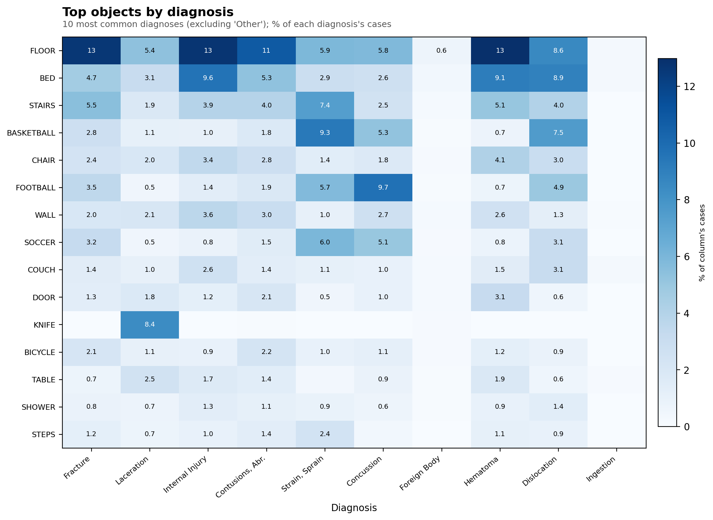
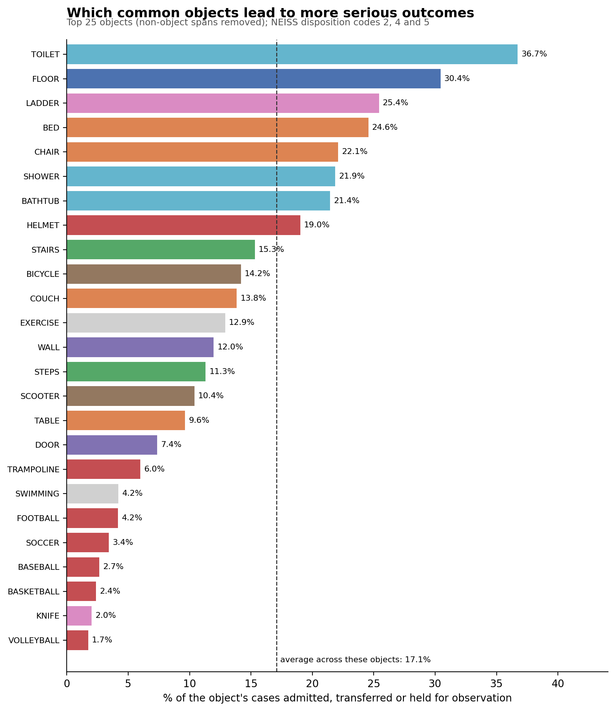
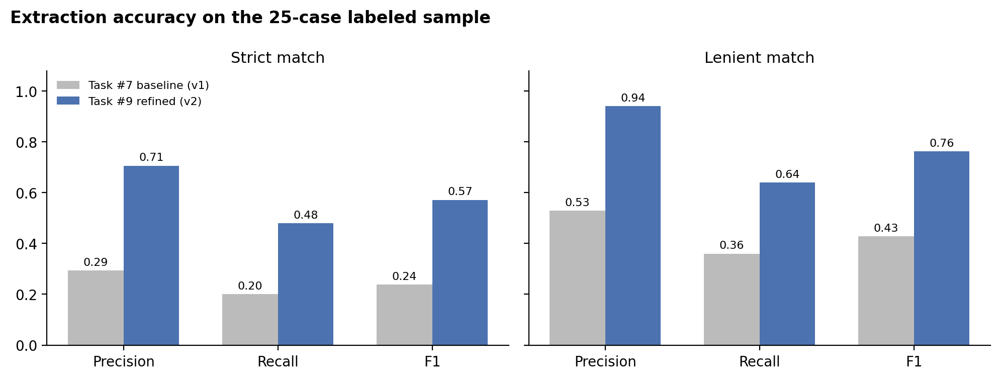

# Key findings: charts

Marsh McLennan 1A, Break Through Tech AI Studio, Fall 2026
Milestone 2, Task #12

Charts of the objects extracted from all 410,201 NEISS 2025 narratives in the v4 full run, built from the Task #11 tables (`task11_object_ranking.csv`, `task11_object_by_field.csv`). Generated by `python -m src.visualize`; PNGs are in `reports/figures/` and can be dropped into the final slides or write-up.

## 1. Most frequently extracted objects

- **FLOOR** is by far the most common object: 37,626 cases, 9.7% of cases with an extracted object. The next three, BED, STAIRS, BASKETBALL, add another 12.3%.
- The top 25 mix home furnishings (bed, chair, couch, table), building structure (stairs, wall, door) and sports equipment (basketball, football, trampoline). Many of them (floor, bed, stairs, chair) are typical fall surfaces.
- Several near-duplicates appear separately (STAIRS / STEPS / FLIGHT OF STAIRS, BICYCLE / BIKE), so normalizing synonyms would push stairs past BED into second place.

## 2. How cases are spread across objects

- 20,637 cases (5.0%) got no object (OTHER).
- The top 10 objects cover 34% of extracted cases and the top 50 cover 54%, but there are 25,877 distinct objects and 17,427 of them appear only once.
- The long tail includes spelling variants, modifiers ("TILE FLOOR", "KITCHEN KNIFE") and rare products. A normalization step that maps these to canonical names is the clearest next improvement.

## 3. Distribution across object categories

- The 150 most frequent objects were hand-grouped into categories (mapping in `src/visualize.py`). **Furniture and beds** is the largest group at 14.8% of extracted cases, driven almost entirely by FLOOR.
- Sports and recreation: 12.1%; Floors and ground: 10.8%; Stairs and steps: 6.5%; Walls, doors and fixtures: 5.3%; Bikes, scooters and vehicles: 4.5%.
- About 1.4% of extracted cases are spans that are not products at all (STRIKING HEAD, SYNCOPE, TWISTED ANKLE, rooms like GARAGE). These are extraction errors worth adding to the stoplist.

## 4. Objects by patient and incident fields

Each heatmap cell is the share of that column's cases (excluding OTHER) that involve the object, for the top 15 objects.

### Age group

- FLOOR rises steeply with age: 6% of cases for ages 0-4 versus 20% for 65+, consistent with falls in older adults.
- Young children (0-4) are most often hurt by BED and COUCH; ages 5-24 by BASKETBALL and other sports equipment.

### Location

- HOME is the largest known location (143,176 extracted cases); beds, couches and floors lead there.
- SPORTS locations are dominated by balls (BASKETBALL, BALL, FOOTBALL); STREET by BICYCLE, HELMET and SCOOTER.

### Body part

- KNIFE and DOOR stand out for FINGER injuries, and WALL / KNIFE for HAND; nearly every other body part is led by FLOOR.

### Diagnosis

- FLOOR accounts for nearly a quarter of fractures; KNIFE narrowly leads lacerations; BASKETBALL ties STAIRS as the top non-floor object for strains and sprains.

## 5. Severity: admissions by object

- Fall-related objects have the highest share of serious outcomes: TOILET 37%, FLOOR 30%, LADDER 25%, BED 25% of cases were admitted, transferred or held.
- Sports objects and KNIFE are mostly treated and released.

## 6. Extraction accuracy (context for the numbers above)

- The v2 rules (stoplist and floor default) raised strict F1 from 0.24 to 0.57 and lenient F1 from 0.43 to 0.76.
- The labeled sample is only 25 cases, so treat these scores as rough.

## Limitations

- Objects are model predictions, not ground truth, so every count inherits the extraction error above.
- FLOOR is inflated by the Task #9 default rule (a fall with no named object becomes FLOOR).
- Category groupings are hand-assigned for the top 150 objects only and are a judgment call.
- Field breakdowns only cover the top 25 objects (the Task #11 table) and exclude OTHER.
- NEISS case weights are not applied: counts are sampled ED visits, not national estimates.
